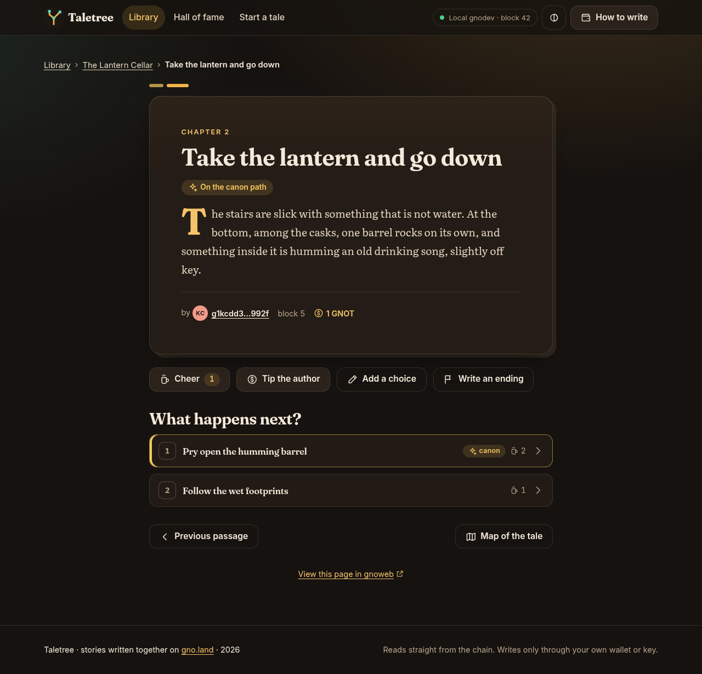
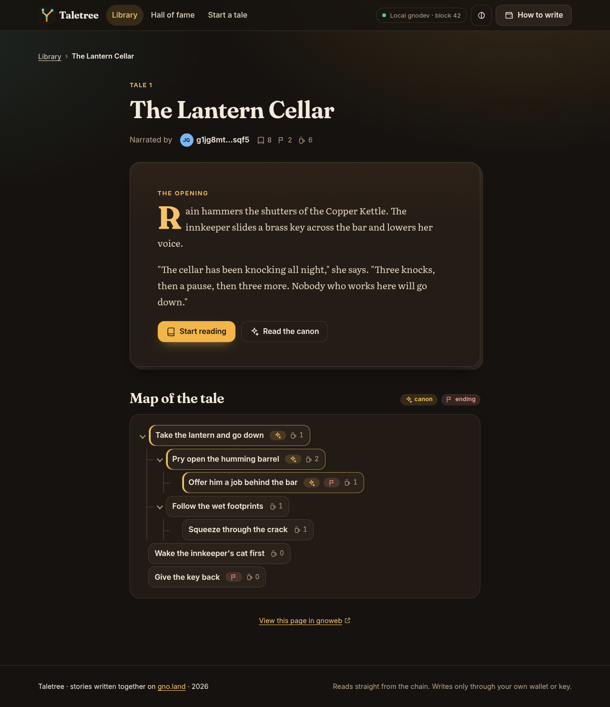
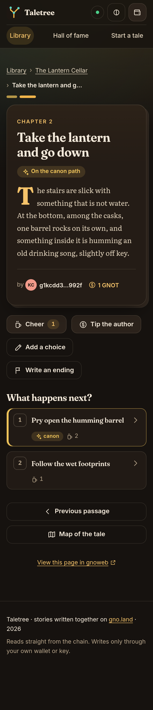
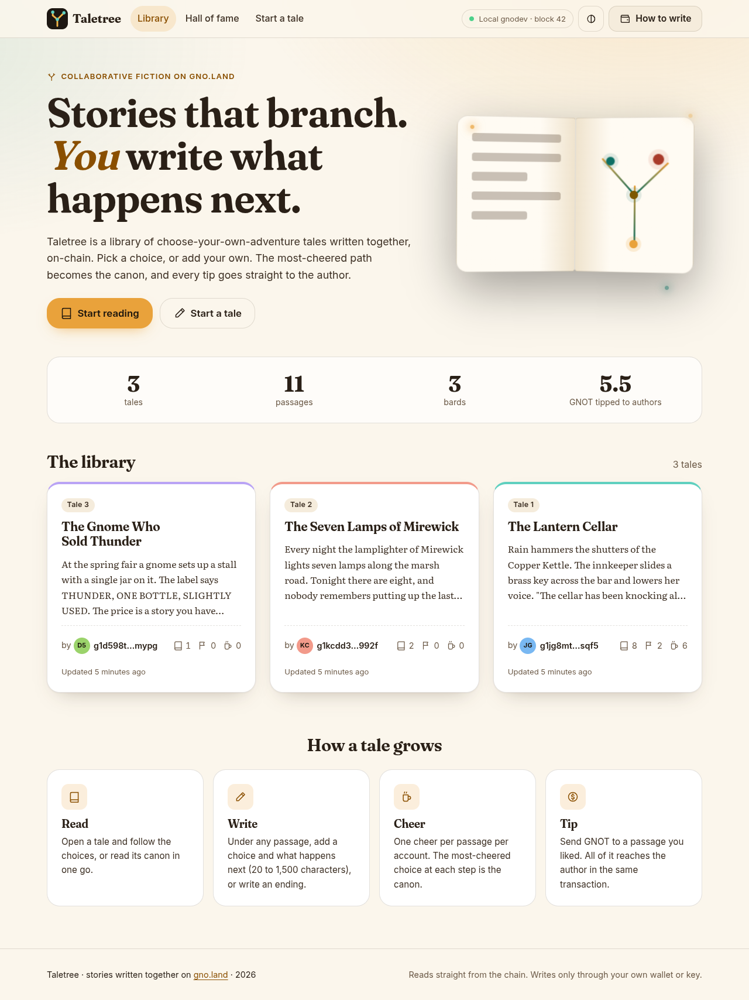
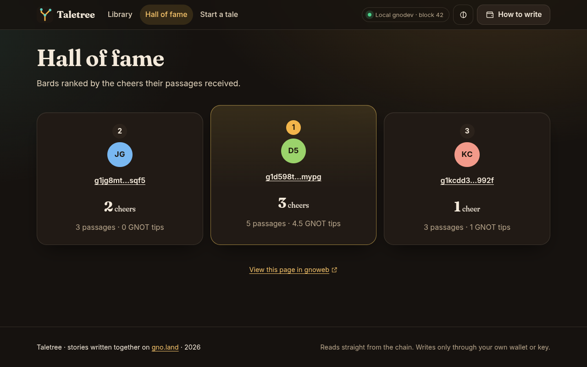
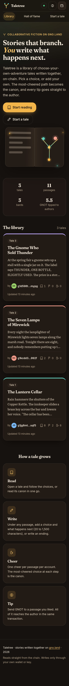

# 🌳 Taletree

**Stories that branch. You write what happens next.**

Taletree is a Gno.land realm for collaborative choose-your-own-adventure
stories. Anyone can start a tale. Anyone can add the next passage under any
passage, as a new choice, or close a path with an ending. Readers cheer the
passages they like, and the most-cheered choice at each step becomes the
tale's **canon**: one read-through picked by readers. Tips go straight to the
author, in the same transaction.

Everything runs in gnoweb. Every passage is a page, every choice is a link,
and every action is one click in gnoweb's Actions tab (or one `gnokey`
command). For a richer read, the repository also ships an optional
[web app](#web-app) (`web/`): a static site that reads the realm straight from
a node and writes through the Adena wallet or a copy-ready `gnokey` command.



- **Live on testnet (Onyx, chain `onyx-1`):** [`gno.land/r/g1k2u0zja7uyfwxfhsau8upj34tynmxkrzvwz35a/taletree/v0`](https://onyx.testnets.gno.land/r/g1k2u0zja7uyfwxfhsau8upj34tynmxkrzvwz35a/taletree/v0)
- **Demo video, web app (2 min 11 s):** [`docs/demo-web.mp4`](docs/demo-web.mp4): the library, reading a branch like a book, an ending, the canon, the hall of fame, then a new choice, a cheer and a tip signed for real with `gnokey` on a local chain.
- **Demo video, gnoweb (90 s):** [`docs/demo.mp4`](docs/demo.mp4): the same story in gnoweb, writing from the Actions form.

## Why

Branching fiction is a natural fit for a chain where every contract renders
its own pages:

- the story tree is shared state that nobody owns, and anyone can extend it;
- authorship is a signature, so credit and tips go to the right person;
- the rules (one cheer per account, tips forwarded in full, who can moderate)
  are in the source, readable next to the story.

## How to use

### Read

Open the realm in gnoweb. From the home page, pick a tale, then either
**Start reading** and follow the choices, or **Read the canon** to get the
readers' favourite path in one page.

| Page | Path |
|---|---|
| Home: totals and tales, newest first | `/r/<ns>/taletree/v0` |
| A tale: opening and map of branches | `:tale/<id>` |
| The canon, as one continuous read | `:tale/<id>/canon` |
| A passage with its choices and actions | `:p/<id>` |
| A writer's profile | `:bard/<address>` |
| Hall of fame (cheers received) | `:bards` |

### Write, cheer, tip

Each passage page has buttons for **Add a choice**, **Write an ending**,
**Cheer** and **Tip 1 GNOT**. They open gnoweb's Actions tab with the
arguments filled in: sign with a browser wallet such as Adena, or copy the
`gnokey` command it shows. The same calls from a terminal:

```sh
REALM=gno.land/r/<ns>/taletree/v0
NET="-gas-fee 50000ugnot -gas-wanted 50000000 -broadcast -chainid onyx-1 -remote https://rpc.onyx.testnets.gno.land:443"

# Start a tale (title, opening). Use \n for a line break.
gnokey maketx call -pkgpath $REALM -func StartTale \
  -args "The Lantern Cellar" -args "Rain hammers the shutters..." $NET mykey

# Add a choice under passage 6 (parent id, choice text, passage text)
gnokey maketx call -pkgpath $REALM -func Branch \
  -args 6 -args "Squeeze through the crack" -args "Behind the wall is a second tavern..." $NET mykey

# Close a path with an ending
gnokey maketx call -pkgpath $REALM -func WriteEnding -args 5 -args "Offer him a job" -args "..." $NET mykey

# Cheer passage 11, then tip its author 1 GNOT
gnokey maketx call -pkgpath $REALM -func Cheer -args 11 $NET mykey
gnokey maketx call -pkgpath $REALM -func Tip -args 11 -send 1000000ugnot $NET mykey

# Read without a transaction
gnokey query vm/qrender -data "$REALM:tale/1/canon" -remote https://rpc.onyx.testnets.gno.land:443
gnokey query vm/qeval -data "$REALM.CanonPath(1)" -remote https://rpc.onyx.testnets.gno.land:443
```

### Rules

- A passage has 20 to 1,500 characters; a choice or title 3 to 80.
- Up to 8 choices under a passage; a tale goes up to 64 passages deep (the
  last level takes endings only).
- Sibling choices must differ (case is ignored).
- One cheer per account per passage, and not on your own passage. The canon
  follows the most-cheered choice at each step; a tie goes to the earliest.
- `Tip` forwards everything sent with the call to the author. It accepts
  `ugnot` only, and only from a direct account call (`gnokey maketx call` or a
  wallet), never through another realm or a `maketx run` script.
- The narrator of a tale (who started it) can hide passages in it and lock
  it. The realm keeper (the deployer, transferable) can do the same in any
  tale and can pause writing. Hidden passages, and everything under them,
  stop rendering; `Unhide` brings them back.

## API

| Function | Kind | What it does |
|---|---|---|
| `StartTale(title, opening) int` | crossing | new tale, returns its id |
| `Branch(parentID, choice, body) int` | crossing | new passage, returns its id |
| `WriteEnding(parentID, choice, body) int` | crossing | new ending passage |
| `Cheer(passageID)` | crossing | +1 cheer, once per account |
| `Tip(passageID)` + `-send` | crossing | forwards the sent ugnot to the author |
| `Hide(passageID, reason)`, `Unhide(passageID)` | crossing | narrator or keeper |
| `LockTale(taleID)`, `UnlockTale(taleID)` | crossing | narrator or keeper |
| `SetPaused(bool)`, `TransferKeeper(address)` | crossing | keeper |
| `GetTale(id)`, `GetPassage(id)` | read | value copies (`TaleView`, `PassageView`) |
| `CanonPath(taleID) []int` | read | passage ids of the canon |
| `TaleCount`, `PassageCount`, `BardCount`, `TotalTips`, `HasCheered`, `Keeper`, `IsPaused` | read | totals and checks |
| `StatsJSON()`, `TalesJSON(page, size)`, `TaleJSON(id)`, `PassageJSON(id)`, `CanonJSON(id)`, `FameJSON(limit)`, `BardJSON(addr)` | read | one JSON document per call, for web clients (`vm/qeval`) |

Events for indexers: `TaleStarted`, `PassageWritten`, `Cheered`, `Tipped`,
`PassageHidden`, `PassageUnhidden`, `TaleLocked`, `TaleUnlocked`,
`PauseChanged`.

Other realms can import the read API to embed a tale, for example to show the
canon of a story on their own page. The `*JSON` functions serve off-chain
clients: each returns one bounded JSON document (hidden passages left out,
exactly as on the pages), so a web page needs one query per screen:

```sh
gnokey query vm/qeval -remote 127.0.0.1:26667 \
  -data 'gno.land/r/<address>/taletree/v0.PassageJSON(5)'
```

## Web app

`web/` is a static site (HTML, CSS and vanilla JavaScript modules; no
framework, no build step, no third-party script, fonts served locally) that
turns the realm into a reading app:

- a warm, bookish design: a dark brown "tavern" palette (with a light theme),
  serif headings, an illustrated book hero and colour-coded tale cards;
- a library of tale cards, a hero with live totals, and a hall of fame with a podium;
- a reader with a wide, calm reading column (serif text for the story): one
  page per passage, a path bar and breadcrumb, canon markers, number keys to
  pick a choice, page transitions (View Transitions API) and a map of every branch;
- forms to start a tale, add a choice or write an ending, with byte counters
  that match the realm's limits (3 to 80 for titles and choices, 20 to 1,500
  for passages) and inline validation;
- cheers with a little "+1", tips with a coin burst, light confetti on endings;
- skeleton loading, friendly empty and "node offline" states with a retry;
- dark and light themes (system default, with a toggle), `prefers-reduced-motion`
  respected, works at 375 px, WCAG AA contrast, 44 px touch targets.


| Map of a tale | Phone (375 px) | Signing with gnokey |
|---|---|---|
|  |  |  |

| Light theme | Hall of fame | Phone, library |
|---|---|---|
|  |  |  |

All screenshots (dark and light, desktop and 375 px, every route plus the
compose, gnokey and "node offline" states) are in
[`docs/screenshots/`](docs/screenshots/) as `web-<width>-<theme>-<view>.png`.

**Reading** needs nothing but a node: each screen is one JSON-RPC `abci_query`
on `vm/qeval` calling a `*JSON` function. Every value from the chain is
inserted as text (`textContent`), never as HTML, and the page runs under a
strict Content Security Policy (no inline script or style, `connect-src`
limited to local nodes and `*.gno.land`).

**Writing** has two paths, and the page never asks for a recovery phrase or a
password:

- **Adena**: with the [Adena](https://www.adena.app/) extension installed,
  "Connect Adena" calls `AddEstablish`, switches Adena to the configured chain
  (adding it with `AddNetwork` if needed), and each action is a `DoContract`
  with one `/vm.m_call` message for you to approve.
- **gnokey**: without Adena, each action opens a dialog with the exact
  `gnokey maketx call` command (quoted for a POSIX shell) and a link to the
  same action in gnoweb. Run it with your key, then press "I ran it, refresh".

### Run it

```sh
# against the live Onyx deployment (default config): just serve the folder
cd web && python3 -m http.server 5173 --bind 127.0.0.1
# open http://127.0.0.1:5173

# or against a local chain: start gnodev, then use the local settings
gnodev local -node-rpc-listener 127.0.0.1:26667 -web-listener 127.0.0.1:8898 .   # from the repository root
cp web/config.local.js web/config.js   # in another terminal
```

Any static file server works. The site must be served over HTTP (ES modules
do not load from `file://`).

### Configure

All settings are in [`web/config.js`](web/config.js): `rpc`, `chainId`,
`chainName`, `realmPath`, `gnoweb`, `gnokeyRemote`, gas settings and tip
presets. The default points at the live Onyx deployment; `web/config.local.js`
holds the local gnodev values. For another deployment of your own:

```js
rpc: "https://rpc.onyx.testnets.gno.land",
chainId: "onyx-1",
chainName: "Gno.land Onyx",
realmPath: "gno.land/r/<your address>/taletree/v0",
gnoweb: "https://onyx.testnets.gno.land",
gnokeyRemote: "https://rpc.onyx.testnets.gno.land:443",
```

Both gnodev and the Onyx RPC answer CORS requests from any origin
(`Access-Control-Allow-Origin: *`), so no proxy is needed. If you point the
app at a node that does not, serve the site and a small reverse proxy for
`/rpc` from the same origin, and add that origin to `connect-src` in
`web/index.html`.

## How it is built

- State lives in `avl.Tree`s keyed by `seqid` ids: tales, passages, cheers
  (`passage + address`), writer totals, a per-writer passage index, and a
  ranking index (`inverted cheers + address`) kept sorted on every cheer, so
  the hall of fame never scans all writers.
- Callers come from `cur.Previous()` in crossing functions. `Tip` pairs
  `cur.Previous().IsUserCall()` with the `OriginSend` amount check, as
  recommended in *Effective Gno*, and the realm never holds a balance after a
  call.
- Every bit of user text goes through `p/nt/markdown/sanitize/v0` (`Block`
  for passages, `InlineText` for titles and choices), so nobody can inject
  headings, gnoweb buttons or fake action links into a page.
- Pages are routed with `p/nt/mux/v0`, action links built with
  `p/moul/txlink/v0`, the tale list paged with `p/nt/avl/pager/v0`, and
  writer names resolved through `r/sys/users` when they have registered one.
- Every loop is bounded by the limits above, so each transaction and each
  `Render` has a fixed upper cost.

Design notes and the idea survey: [`DESIGN.md`](DESIGN.md).

## Run it locally

Requires the Gno toolchain **v1.8.0** (the version the Onyx testnet runs):

```sh
git clone https://github.com/gnolang/gno.git && cd gno && git checkout v1.8.0 && make install
```

Then, from this repository:

```sh
cd realm
gno test -v .          # 16 unit tests + 2 filetests
gnodev .               # local chain + gnoweb at http://127.0.0.1:8888
```

The module path in `realm/gnomod.toml` uses the `devtest` address that
gnodev deploys with. To fill the local chain with three tales, add two more
local test keys to your keybase (gnodev funds every key it finds) and run:

```sh
KEY_A=devtest KEY_B=bard2 KEY_C=bard3 ./scripts/demo.sh
```

## Deploy

```sh
KEY=<your key name> ADDR=<your g1 address> ./scripts/deploy.sh
```

The script copies `realm/` to a temp dir, rewrites the module path to
`gno.land/r/<ADDR>/taletree/v0`, runs the tests on that copy, and sends one
`addpkg` to the Onyx testnet. Measured on a local gnodev: about 115M gas and a
storage deposit of 12.52 GNOT (125,242 bytes), so the key needs about
12.8 GNOT from the [faucet](https://faucet.gno.land).

## Layout

```text
realm/
  doc.gno          package doc and routes
  store.gno        types, state, limits, canon and ancestry walks
  taletree.gno     crossing functions (write, cheer, tip, moderate)
  api.gno          read API for other realms and vm/qeval
  json.gno         JSON read API for web clients
  render.gno       gnoweb pages
  errors.gno       error values
  taletree_test.gno    unit tests
  json_test.gno        JSON API tests (escaping, hidden passages, paging)
  filetests/       a full story with events; the tip-through-a-realm refusal
scripts/demo.sh    seeds a local chain with real transactions
scripts/deploy.sh  deploys under your namespace
web/
  index.html       app shell and Content Security Policy
  config.js        node, chain and realm settings (the only file to edit)
  css/style.css    design tokens, themes, layout, motion
  js/rpc.js        JSON-RPC abci_query + vm/qeval reader
  js/wallet.js     Adena (window.adena) and gnokey command builder
  js/app.js        router, views, forms, actions
  js/dom.js, js/fx.js   safe DOM helpers, icons; toasts, confetti, transitions
  fonts/           Fraunces and Literata (SIL OFL 1.1), Latin subset
docs/              demo videos and screenshots (desktop and 375 px)
```

## Credits

Built for the Gnome Tavern hackathon on Gno.land. Made with the help of AI
(Claude) for code, tests and docs; every function was run and tested on a
local gnodev chain. Uses packages from the Gno monorepo (`p/nt/*`,
`p/moul/txlink`). The web app uses the Fraunces and Literata typefaces
(SIL Open Font License 1.1, licence files in `web/fonts/`).

## License

The source in this repository is released under the [MIT License](LICENSE).
Fonts in `web/fonts/` keep their own SIL Open Font License 1.1 files. Code
published on the Gno.land chain is also subject to the Gno.land network
license terms.
